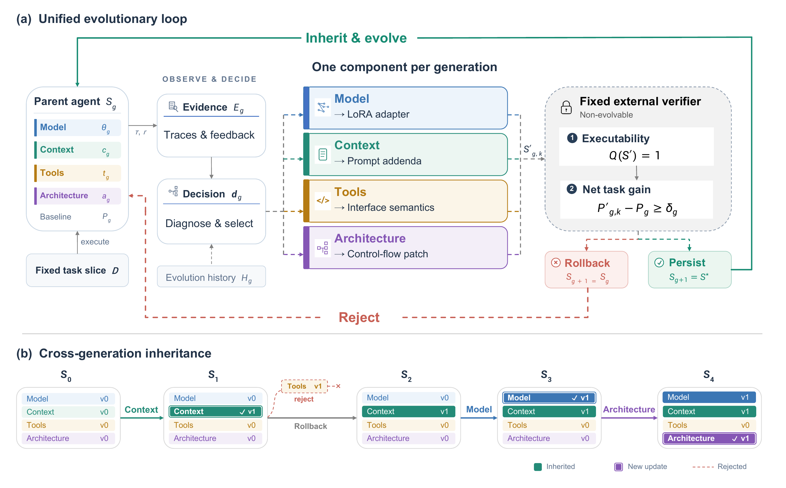
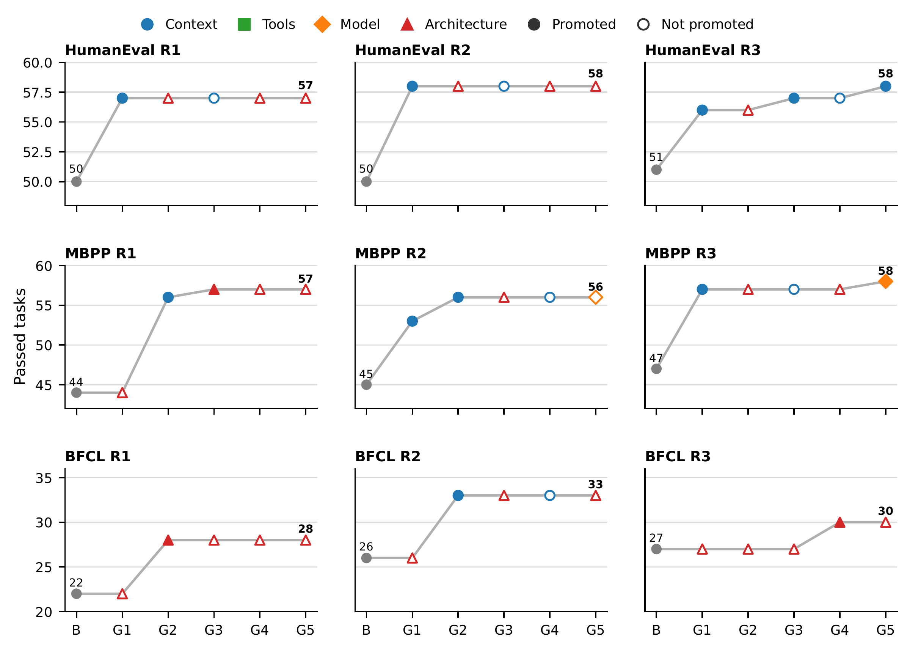

<h1 align="center">StrataEvo</h1>
<h3 align="center">A Unified Framework for Component-Wise Self-Evolution of LLM Agents</h3>

<p align="center">
  <strong>Turning task experience into continual improvement of the whole agent.</strong>
</p>

<p align="center">
  <!-- Replace the two #resources links with the arXiv and Hugging Face URLs when published. -->
  <a href="#resources"></a>
  <a href="#resources"></a>
  <a href="LICENSE"></a>
  <a href="https://github.com/KununK/StrataEvo"></a>
</p>

<p align="center">
  <a href="#overview">Overview</a> ·
  <a href="#results">Highlights</a> ·
  <a href="#quick-start">Quick Start</a> ·
  <a href="#resources">Paper & Resources</a>
</p>

**Can an agent learn to improve itself from its own successes and failures?**

StrataEvo brings **Model, Context, Tools, and Architecture** into a unified self-evolution framework.
It identifies problems in execution traces, autonomously selects a component to modify, generates candidates,
and uses task performance to determine which updates the next generation inherits.
From model weights and task prompts to tool interfaces and control logic, all updates follow the same evolutionary loop.

<p align="center">
  <b>4 evolvable components</b> &nbsp; · &nbsp;
  <b>3 main benchmarks</b> &nbsp; · &nbsp;
  <b>Gains in 9/9 independent runs</b>
</p>

<a id="overview"></a>
## Overview

<p align="center">
  
</p>

**Execute, diagnose, improve, verify, inherit.** Each generation focuses on one component, with a fixed verifier evaluating candidates.
Effective updates persist across tasks; candidates that are not promoted are rolled back to the parent state.

| Component | How the agent improves itself |
|---|---|
| **Model** | Fine-tunes with LoRA using verifier-passing repairs and successful trajectories |
| **Context** | Distills task experience into persistent system and task prompts |
| **Tools** | Refines tool descriptions and usage guidance to improve tool selection and invocation |
| **Architecture** | Uses an independent MetaAgent to modify the task agent's control flow and message-management code |

### Why StrataEvo?

- **Improve the whole agent.** Four components are updated independently and inherited together, supporting both autonomous selection and component-level research.
- **Put proposed changes to the test.** Prompts, tool descriptions, adapters, and source patches share a common verification, promotion, and rollback process.
- **Go beyond code generation.** Systematic experiments span HumanEval, MBPP, and BFCL V4, with further transfer evaluation on SWE-bench Verified.
- **Lightweight, open, and extensible.** A compact task agent and evolution controller preserve task trajectories, candidate changes, and generation-level results for reproduction and further research.

<a id="results"></a>
## Experimental Highlights

All experiments use **Qwen3-Coder-30B-A3B-Instruct**. Self-evolution can be reproduced on a single NVIDIA A100 80GB GPU.

### Autonomous Evolution: Improvements Across Three Benchmarks

| Benchmark | Baseline | Final | Pass Rate Gain |
|---|---:|---:|---:|
| HumanEval | 144/164 (87.80%) | **156/164 (95.12%)** | **+7.32 pp** |
| MBPP | 200/257 (77.82%) | **232/257 (90.27%)** | **+12.45 pp** |
| BFCL V4 | 100/200 (50.00%) | **123/200 (61.50%)** | **+11.50 pp** |

Across the benchmarks, StrataEvo passes **67 additional tasks**, raising the overall pass rate from **71.50% to 82.29%**.

### Independent Replications: Net Gains in All 9 Runs

Each benchmark is evaluated in 3 independent runs. The trajectories below show the selected component,
candidate promotion, and retained performance at each generation.

<p align="center">
  
</p>

Context, Tools, and Model all produce effective updates in the single-component experiments.
Architecture achieves **10/12 successful repairs** across controlled premature-termination and history-overwrite defects.

### Cross-Task Transfer: Evolve on the Training Set, Evaluate on New Tasks

After evolution on MBPP train, the final state is fixed and evaluated directly on MBPP test, HumanEval, and SWE-bench Verified.

| Target Set | Baseline | Final | Net Gain |
|---|---:|---:|---:|
| MBPP test | 198/257 | **230/257** | **+32** |
| HumanEval | 135/164 | **152/164** | **+17** |
| SWE-bench Verified | 161/500 | **171/500** | **+10** |

See [Experimental Results](docs/experiments.md) for the full independent runs, four-component matrix, structural repairs, and transfer analysis.

<a id="quick-start"></a>
## Quick Start

Requires Linux, Python 3.12, Git, [uv](https://docs.astral.sh/uv/), and an available model inference service.
Local inference and LoRA training use NVIDIA GPUs.

### Installation

```bash
git clone https://github.com/KununK/StrataEvo.git
cd StrataEvo
uv sync --locked
source .venv/bin/activate
```

### Start the Model Server

```bash
CUDA_VISIBLE_DEVICES=0 bash scripts/serve.sh
```

The default model is Qwen3-Coder-30B-A3B-Instruct, with tool calling and dynamic LoRA loading enabled.
To use an existing OpenAI-compatible service, specify `--model` and `--base-url`.

### Run Self-Evolution

```bash
strataevo \
  --branch evo-demo \
  --run-name humaneval-demo \
  --benchmark humaneval \
  --generations 3 \
  --eval-limit 20 \
  --eval-workers 4
```

This creates or switches to the experiment branch, evaluates the initial agent, and starts autonomous improvement.
Keep the Git working tree clean before running.
To enable autonomous selection across all four components, including Model training:

```bash
strataevo \
  --branch evo-four-components \
  --run-name mbpp-demo \
  --benchmark mbpp \
  --generations 3 \
  --eval-limit 32 \
  --enable-model-evolution \
  --sft-device 1 \
  --sft-max-length 4096
```

See the [Evaluation Guide](docs/evaluation.md) for more benchmarks, model configuration, and resume commands.

## Supported Tasks

| Task Domain | Benchmark | Integration |
|---|---|---|
| Function and short-program generation | HumanEval, MBPP | File and shell tools for coding, followed by executable tests |
| Multi-turn tool interaction | BFCL V4 `multi_turn_base` | Official function environment, state backend, and checker |
| Repository-level software repair | SWE-bench Verified | Repository workspace and tools produce a patch, scored by an external SWE harness |

HumanEval, MBPP, and BFCL have direct evaluation entry points.
See [Cross-Benchmark Evaluation](docs/generalization.md#swe-bench-verified-integration) for SWE workspaces, patch generation, and test integration.

## Learn More

| Document | Contents |
|---|---|
| [Evolution](docs/evolution.md) | Four components, verification, and cross-generation inheritance |
| [Evaluation Guide](docs/evaluation.md) | Benchmark setup, commands, and result inspection |
| [Experimental Results](docs/experiments.md) | Full paper results and configurations |
| [Cross-Benchmark Evaluation](docs/generalization.md) | MBPP train evolution and SWE integration |

We welcome reproduction results, new task environments, and new approaches to component-wise evolution
through [Issues](https://github.com/KununK/StrataEvo/issues) and Pull Requests.

<a id="resources"></a>
## Paper & Resources

- **Paper**: *StrataEvo: A Unified Framework for Component-Wise Self-Evolution of LLM Agents*.
- **arXiv**: Link coming soon.
- **Hugging Face**: Resources coming soon.
- **Code**: [KununK/StrataEvo](https://github.com/KununK/StrataEvo).

## License

[MIT](LICENSE). Models and third-party benchmarks retain their respective licenses.
Run model-generated code in an isolated experimental environment.
